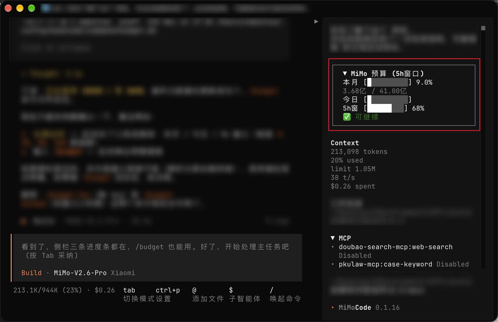
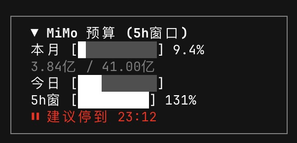

<div align="center">

# mimo-usage-budget

**MiMo Token Plan 预算面板** —— 给自己加一个「5 小时限额」，别让月额度两天烧光

</div>



Token Plan 只有月度总额度，没有 Codex 那种 5 小时限速。mimo-usage-budget 把月额度**摊到每天、再摊到 5 小时滚动窗口**：窗口用超了就提示你停到某个时刻（是你自己刹住，额度本身不会重置）。额度只统计 Token Plan 模型的消耗——**切到免费/按量模型不计数、不误报**。

## 适用人群

- 用 MiMo Code + Token Plan 写代码，担心自己刹不住车、两天烧光额度
- 希望有 Codex 式「5 小时限量」的使用节奏
- 会混用免费 / 按量模型，不想被预算警告误伤

## 安装

### 🤖 AI 安装（推荐）

把下面这段话直接发给你的 AI 编程助手（MiMo Code / Claude Code / Codex 都行）：

```text
请帮我安装并配置 mimo-usage-budget（先 clone 本仓库并进入目录）：

1. 安装 TUI 插件：运行 `mimo plugin ./plugin -g`（自动写入 ~/.config/mimocode/tui.json）
2. 复制 command/budget.md 到 ~/.config/mimocode/command/budget.md
3. 复制 config.example.json 到 ~/.mimo-usage-budget/config.json，
   然后引导我到开放平台 Token Plan 页领取 tp- 开头的专属 API Key，
   填入 tp_api_key 字段（暂时拿不到就先留空）
4. 可选：配置每 10 分钟定时采样。**注意**：macOS 隐私保护禁止 launchd 读取 Desktop / Documents / Downloads 里的文件，项目放在这几处时该项无效、会静默失败；此时跳过即可——MiMo Code 开着时插件每分钟自动采样，够用
5. 验证：运行 python3 budget.py show，能输出面板即安装成功
6. 最后提醒我重启 MiMo Code，让侧栏插件生效
```

### 🔧 手动安装

```bash
git clone <repo-url> && cd mimo-usage-budget
mimo plugin ./plugin -g                               # TUI 侧栏插件
cp command/budget.md ~/.config/mimocode/command/       # /budget 命令
mkdir -p ~/.mimo-usage-budget
cp config.example.json ~/.mimo-usage-budget/config.json      # 然后填入 tp_api_key
```

重启 MiMo Code 后，侧栏会出现「MiMo 预算」面板。

## 使用



- **侧栏常驻**：本月 / 今日 / 5h 窗口三条进度，附判断结论（✅ 可继续 / ⏸ 建议停到 HH:MM）
- **斜杠命令**：`/budget` 调出面板，`/budget-key` 填 key，`/budget-window` 调窗口时长
- **命令行**：

```bash
python3 budget.py show    # 一次性仪表盘
python3 budget.py watch   # 常驻刷新（放终端分栏里瞄一眼）
python3 budget.py check   # 一行结论，exit 0=可继续 2=建议暂停
```

**数据从哪来**：本月额度直接取自 API；**今日与 5h 窗口**由本地采样推算——MiMo Code 开着时插件每分钟记一次，采样越密越准。采样停超过 15 分钟，面板会提示「⚠ 采样已停 N 分钟」，此时这两条是**外推值**，别当实数。

## 配置

`~/.mimo-usage-budget/config.json`（凭证二选一，推荐 tp- key）：

| 字段 | 说明 |
|---|---|
| `tp_api_key` | Token Plan 专属 key（`tp-` 开头），开放平台 Token Plan 页领取 |
| `cookie` | 备用：平台控制台 Cookie |
| `window_hours` | 滚动窗口小时数，默认 `5` |
| `pacing` | `adaptive`（默认：剩余额度摊到剩余天数）或 `fixed` |

判断逻辑：窗口预算 = 日预算 × window_hours ÷ 24；今日与窗口用量由采样序列**线性插值**推算（断档期间的消耗按时间比例摊开，不会整段堆到恢复采样那一刻），超出时计算窗口滑动的恢复时刻。


> TUI 插件实现参考了 MIT 许可的 [mimo-ds-usage-monitor](https://github.com/Enderman112/mimo-ds-usage-monitor)（致谢），该参考部分仍按 MIT 提供。
